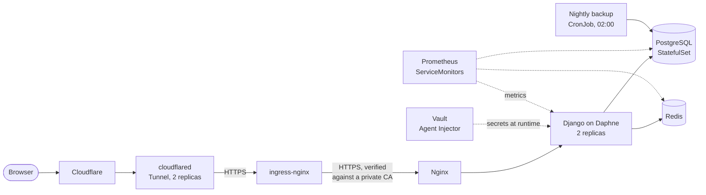
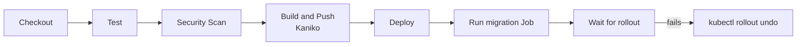

# CampusCart on Kubernetes

A campus e-commerce web app (Django) and the platform I built around it: a self-built 3-node Kubernetes cluster with a Jenkins CI/CD pipeline, plus a second deployment on AWS EKS written in Terraform.

**Portfolio:** [portfolio.bharathops.online](https://portfolio.bharathops.online) · **Running app:** [campuscart.bharathops.online](https://campuscart.bharathops.online)

> **About authorship.** I built the CampusCart application with AI coding tools. My own work is the platform around it: Kubernetes, CI/CD, secrets, TLS, monitoring and AWS infrastructure in Terraform. That is what this repository shows.

## Two environments

| | kubeadm cluster | AWS EKS |
|---|---|---|
| Where | 3 virtual machines I set up with kubeadm (1 control plane, 2 workers, Kubernetes v1.30) | EKS 1.31, provisioned with Terraform |
| Manifests | [`k8s/`](k8s) | [`k8s-aws/`](k8s-aws) |
| Pipeline | [`Jenkinsfile`](Jenkinsfile), 5 stages | [`Jenkinsfile.aws`](Jenkinsfile.aws), 11 stages now (9 as deployed; Test and Security Scan were added after teardown and have never run) |
| Status | Running | Completed deployment, infrastructure torn down |

## kubeadm architecture



- **Public access** goes through a Cloudflare Tunnel (`cloudflared`, 2 replicas) that forwards to ingress-nginx.
- **Internal TLS:** cert-manager issues certificates from a private CA. ingress-nginx verifies the Nginx certificate before it forwards a request.
- **Secrets:** pods read their database credentials and app secrets from Vault when they start. The web pods get dynamic database credentials and re-read them on each new connection. No secret values are in this repository.
- **Reliability:** the web Deployment has 2 replicas, a PodDisruptionBudget, and startup, readiness and liveness probes. PostgreSQL runs as a StatefulSet with a nightly backup CronJob.
- **Monitoring:** ServiceMonitors for the web app, PostgreSQL and Redis feed Prometheus. The Django app exposes its own metrics with django-prometheus.

## CI/CD pipeline (kubeadm)



1. **Checkout** tags each image with the short hash of the last commit that touched it, and asks the registry whether that tag already exists.
2. **Test** runs `manage.py test` against PostgreSQL and Redis containers. It is skipped when the image already exists.
3. **Security Scan** runs `bandit` and `pip-audit` before anything is built, so a failed scan leaves no image in the registry.
4. **Build and Push** builds the web and Nginx images with Kaniko, in separate containers, and pushes them to a private registry.
5. **Deploy** runs the database migration as a Kubernetes Job, applies the manifests, then waits for the rollout. If the new pods do not become ready in time, it runs `kubectl rollout undo`.

Jenkins deploys with its own ServiceAccount. A namespace-scoped Role limits what it may change, and that Role has no rule for Secrets ([`k8s/jenkins-deployer-rbac.yaml`](k8s/jenkins-deployer-rbac.yaml)). A separate pipeline, [`Jenkinsfile.security`](Jenkinsfile.security), runs a dependency audit and a Trivy image scan.

## AWS environment (Terraform)

Infrastructure is split into 7 modules under [`terraform/modules`](terraform/modules): `networking`, `eks`, `rds`, `elasticache`, `ecr`, `iam` and `iam-irsa`.

- Remote state in S3 with native state locking, encryption and versioning.
- A VPC across 2 Availability Zones with public and private subnets, EKS with a managed node group on Spot instances, RDS PostgreSQL and ElastiCache Redis.
- The database password is generated by Terraform, stored in AWS Secrets Manager and synced into the cluster by External Secrets Operator.
- IRSA roles for External Secrets Operator and the AWS Load Balancer Controller. Both are installed with Terraform `helm_release`.
- An Application Load Balancer with path-based routing (`/api`, `/ws` and `/`) and a HorizontalPodAutoscaler from 2 to 6 replicas.
- [`Jenkinsfile.aws`](Jenkinsfile.aws) shows the Terraform plan and waits for a manual approval before it applies.

This environment was deployed and has since been torn down. The Terraform and manifests remain as the record of what I built.

## What I would improve next

I would rather list these than hide them:

- **HTTPS on the AWS load balancer.** The ALB listens on HTTP only. The next step is an ACM certificate and an HTTPS listener.
- **Alerting.** Prometheus collects metrics, but I have not configured alert rules or Alertmanager.
- **A tested restore.** A nightly backup CronJob is configured, but I have not yet practised and documented a restore.
- **A more resilient database on AWS.** RDS is single-AZ, so it is not highly available.
- **Redis encryption on AWS.** ElastiCache is a single node without encryption in transit or at rest.
- **The AWS pipeline** has no rollback stage. Its Test and Security Scan stages were added after the environment was torn down, so they have never run. The kubeadm pipeline has all three and runs them.

## The application

Django 5 with Django REST Framework, JWT authentication, Django Channels and Daphne for WebSockets, Redis, and PostgreSQL. Features: product listings with search, cart and wishlist, orders, Stripe payments, real-time chat, notifications, reviews and a seller dashboard.

```
campuscart-backend/   Django apps: users, products, cart, wishlist, orders,
                      payments, chat, push, reviews
frontend/             static HTML, CSS and JavaScript
nginx/                Nginx image and config
k8s/                  kubeadm manifests
k8s-aws/              AWS EKS manifests
terraform/            AWS infrastructure (7 modules)
monitoring/           Prometheus values
Jenkinsfile*          CI/CD pipelines
```

## Run it locally

```bash
cp .env.example .env     # fill in your own values
docker compose up --build
```

[`docker-compose.yml`](docker-compose.yml) defines the web app, PostgreSQL, Redis and Nginx. Real secrets belong in `.env`, which Git ignores.

## Contact

Bharath Moger · Bengaluru · [bharath.m.moger@gmail.com](mailto:bharath.m.moger@gmail.com) · [LinkedIn](https://www.linkedin.com/in/bharathmoger) · [GitHub](https://github.com/bharathMoger18)
